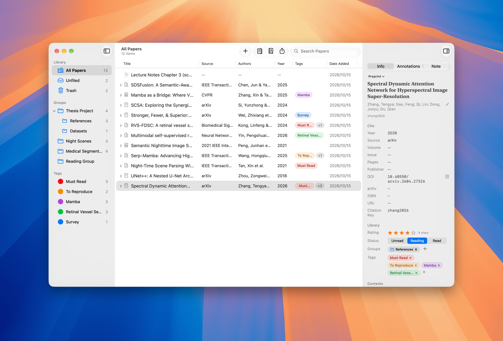
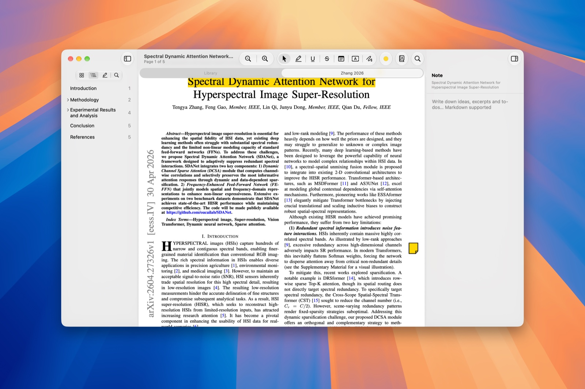
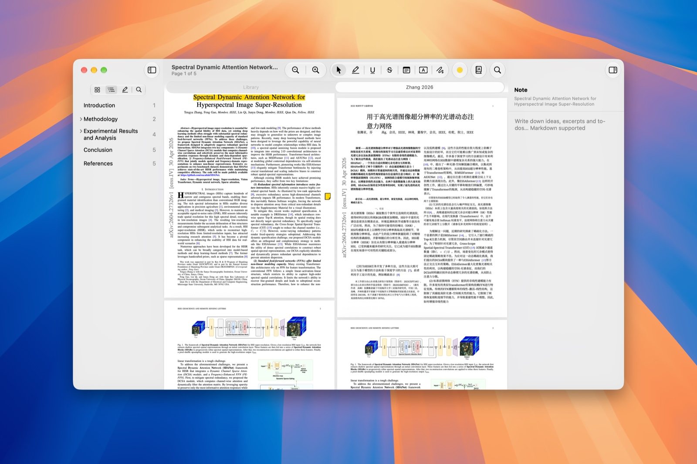
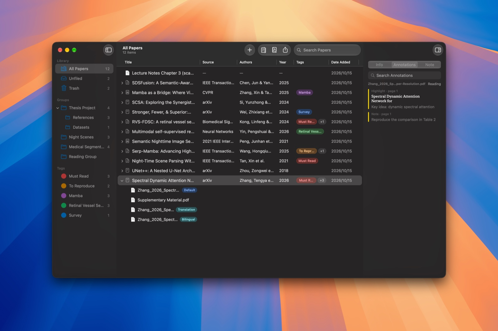
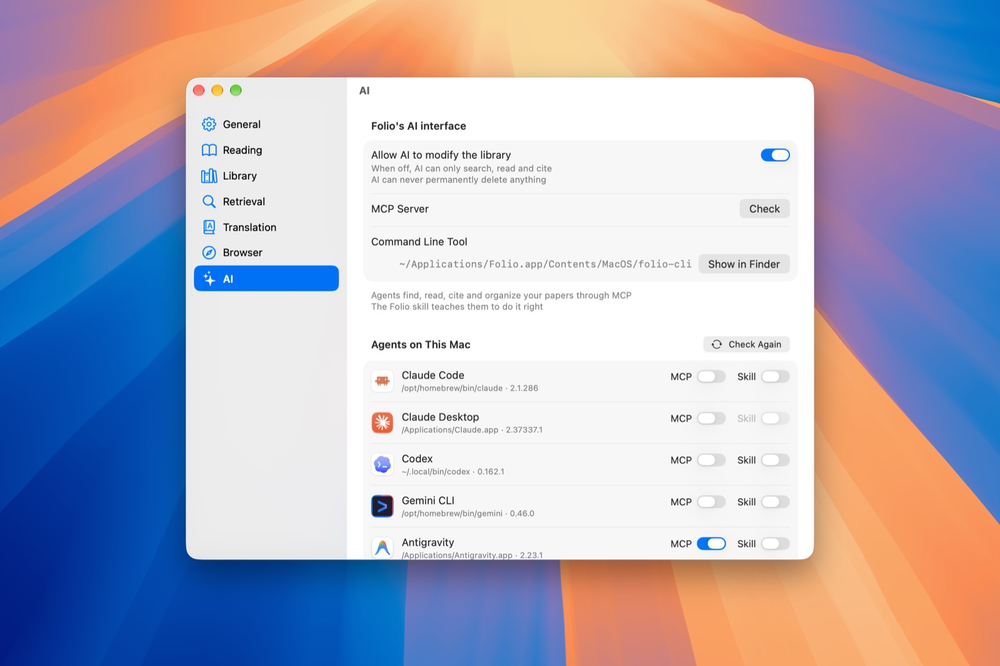

<div align="center">


# Folio

**A lightweight, native reference manager for macOS**

Drop in a PDF and get its metadata · Built-in reader and annotations · Layout-preserving translation · AI agent integration

[](https://github.com/Alonemo-Nnqc/Folio/releases/latest)
[](https://github.com/Alonemo-Nnqc/Folio/actions/workflows/ci.yml)
[](#installation)
[](LICENSE)

[简体中文](README.md) | English



</div>

## Features

- **Automatic metadata**: drop a PDF and Folio identifies its title, authors, venue and DOI within seconds (Zotero recognizer + Crossref / arXiv / OpenAlex / DBLP / CVF), with manual matching as a fallback
- **Built-in reader**: PDFKit, the same engine as Preview. Papers open in native tabs; highlights, underlines, strike-throughs, notes, text boxes and ink are written back into the PDF and stay compatible with Preview. Folio remembers where you stopped reading
- **Full-paper translation**: layout-preserving translation with [pdf2zh_next / BabelDOC](https://github.com/PDFMathTranslate/PDFMathTranslate-next) and 20+ translation services, read side by side with the original
- **Notes**: one Markdown note per item; send selected text from the reader to the note in one click
- **Organization**: two-level colored groups, colored tags, trash, full-text search, reading status and ratings; several files per item
- **Citations and export**: copy GB/T 7714-2015, APA, IEEE, MLA, Chicago, Harvard, Vancouver, Nature or BibTeX citations; export BibTeX / RIS / CSL JSON
- **AI integration**: a built-in MCP server and the `folio-cli` command line tool. Settings ▸ AI connects Folio to 11 agents, including Claude Code, Codex, Gemini CLI, Copilot CLI and Cursor CLI, in one click
- **Browser extensions**: Safari, Chrome, Edge, Brave, Arc, Firefox and more. Save the paper you're viewing (optionally with its PDF), or several papers at once from a results page
- **Zotero import**: items, PDFs, collections and tags, read from a copy of the database (Zotero is never modified)
- **English and Chinese**: follows your system language, or pick one in Settings ▸ General
- **Automatic updates**: checks for updates in the app, downloads in the background and installs on relaunch
- **Fast**: about 0.35 s cold start and 110–130 MB of memory with 1,000 items

## Screenshots

<table>
  <tr>
    <td width="50%"></td>
    <td width="50%"></td>
  </tr>
  <tr>
    <td align="center"><b>Read and annotate</b>: highlights and notes are saved into the PDF</td>
    <td align="center"><b>Side-by-side reading</b>: layout-preserving translation next to the original</td>
  </tr>
  <tr>
    <td width="50%"></td>
    <td width="50%"></td>
  </tr>
  <tr>
    <td align="center"><b>Dark mode</b>: several files per item, annotations at a glance</td>
    <td align="center"><b>AI integration</b>: add the MCP server and skill to your agents in one click</td>
  </tr>
</table>

## Installation

Requires macOS 14 Sonoma or later (Apple silicon or Intel). On macOS 26 Folio uses the Liquid Glass design.

1. Download the latest `Folio-x.y.z.dmg` from [Releases](https://github.com/Alonemo-Nnqc/Folio/releases/latest)
2. Open the disk image and drag **Folio** into Applications
3. First launch: Folio is not notarized by Apple yet, so macOS says it can't verify the developer. Open **System Settings ▸ Privacy & Security**, scroll down and click **Open Anyway**, then confirm. (On macOS 14 you can also Control-click Folio in Finder and choose Open.)

   Alternatively, remove the quarantine attribute in Terminal:

   ```bash
   xattr -dr com.apple.quarantine /Applications/Folio.app
   ```

Later versions install through the in-app updater, so you only need to do this once.

### Updates

Folio checks for updates once a day; you can also choose **Folio ▸ Check for Updates…** at any time. **Settings ▸ General ▸ Software Update** controls automatic checks and background downloads (installed when you quit). Updates are downloaded from GitHub Releases and verified with an EdDSA signature before they are installed.

## Usage

The first time you open Folio, a welcome guide walks you through a few settings (skip any step; reopen it from Help ▸ Welcome to Folio): importing from Zotero when a Zotero library is found, installing the extension in your default browser, adding the MCP server and skill to the AI agents on your Mac, and setting up translation — Folio uses an existing pdf2zh_next, downloads its built-in components, or lets an agent find yours through Folio's MCP server.

- **Add papers**: drag PDFs into the window, or use File ▸ Add Files (⌘O) or Add by Identifier (DOI, arXiv ID or ISBN, ⇧⌘O)
- **Library location**: `~/Folio` by default; change it in Settings ▸ Library
- **Language**: follows the system; pin Simplified Chinese or English in Settings ▸ General ▸ Language (applies after a restart)
- **Translation**: right-click an item ▸ Translate Paper…. The first time, Folio offers to download the translation engine (about 1.4 GB, stored in `~/Library/Application Support/Folio/Translator`); pick a service in Settings ▸ Translation. Apple's offline translation needs macOS 26

### AI integration

`folio-cli` ships inside the app (`/Applications/Folio.app/Contents/MacOS/folio-cli`):

- `folio-cli mcp`: an MCP server over stdio with 26 tools for searching (by author, year, tag, full text), reading full text and annotations, citing in 9 formats, importing and exporting, adding by DOI / arXiv / PDF / URL, managing groups, tags and notes
- `folio-cli search | get | cite | export | add | open` for agents that can only run commands; `folio-cli status` checks the library and permissions
- The Folio skill (`SKILL.md`) teaches agents how to find papers from a description, cite them accurately and when to ask you first

**Settings ▸ AI** lists only the agents available on your Mac, each with an MCP and a skill switch that installs or removes Folio the way that agent's documentation describes. Turn off “Allow AI to modify the library” to give agents read-only access. Editors such as VS Code, Zed and Windsurf can use “Copy MCP Configuration”.

### Browser extensions

While Folio runs, it serves a local connector at `127.0.0.1:23120` that only accepts requests from the extension (it can be turned off in Settings ▸ Browser). Click the Folio toolbar button (or press ⌘⇧S) on a paper's page to save it. Settings ▸ Browser walks you through installation:

- **Safari**: the extension ships inside Folio.app. Because Folio isn't notarized, enable "Show features for web developers" in Safari Settings ▸ Advanced, then "Allow unsigned extensions" in the Developer menu (needed again after Safari restarts), and enable the Folio extension under Extensions
- **Chrome / Edge / Brave / Arc**: click “Install…” in Settings, enable Developer mode on the browser's extensions page and "Load unpacked" the folder Folio prepares. The extension updates itself with Folio
- **Firefox**: "Load Temporary Add-on" from `about:debugging`

Each release also includes the extension as a `.zip` (Chromium) and an `.xpi` (Firefox).

## Privacy

Folio collects no usage data, and your library stays on your Mac. Folio only goes online to:

- Identify metadata: queries to the Zotero recognizer, Crossref, arXiv, OpenAlex, DBLP and similar services (the Zotero recognizer can be turned off)
- Translate papers: the text goes to the translation service you choose (Apple's offline translation is also available)
- Check for updates: reads `appcast.xml` from GitHub Releases (automatic checks can be turned off)

API keys for translation services are stored in the macOS Keychain.

## Building from source

Requires Xcode 27 or later and [XcodeGen](https://github.com/yonaskolb/XcodeGen) (`brew install xcodegen`):

```bash
git clone https://github.com/Alonemo-Nnqc/Folio.git
cd Folio
script/build_and_run.sh
```

No Apple Developer account is needed. See [CONTRIBUTING.md](CONTRIBUTING.md) for the project layout, tests and release process.

## Contributing

[Issues](https://github.com/Alonemo-Nnqc/Folio/issues) and pull requests are welcome. Please read the [contributing guide](CONTRIBUTING.md) and the [code of conduct](CODE_OF_CONDUCT.md) first, and report security issues privately as described in [SECURITY.md](SECURITY.md). Release notes are in [CHANGELOG.md](CHANGELOG.md).

## Acknowledgements

| Project | Used for | License |
| --- | --- | --- |
| [GRDB.swift](https://github.com/groue/GRDB.swift) | SQLite database | MIT |
| [Sparkle](https://github.com/sparkle-project/Sparkle) | In-app updates | MIT |
| [citeproc-js](https://github.com/Juris-M/citeproc-js) | Citation formatting (bundled) | CPAL-1.0 / AGPL-1.0 |
| [CSL styles and locales](https://citationstyles.org) | Citation styles | CC BY-SA 3.0 |
| [pdf2zh_next / BabelDOC](https://github.com/PDFMathTranslate/PDFMathTranslate-next) | Full-paper translation (not bundled; downloaded on first use) | AGPL-3.0 |
| [Zotero recognizer](https://www.zotero.org) | PDF metadata recognition | — |

See [`LICENSES.md`](Packages/FolioCore/Sources/FolioCitation/Resources/LICENSES.md) for the bundled resources.

## License

Folio is released under the [MIT License](LICENSE). Bundled third-party components keep their own licenses.
