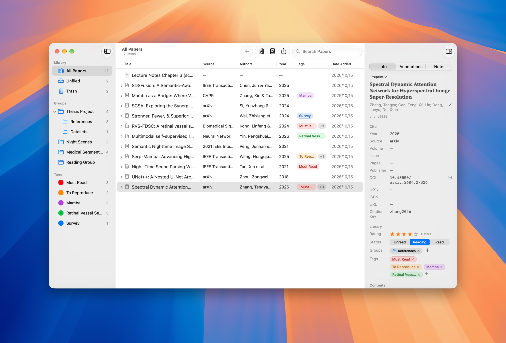
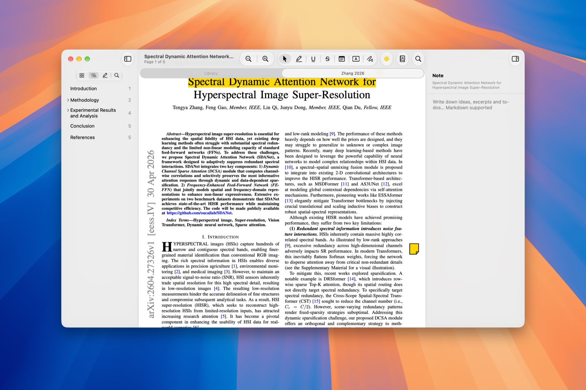
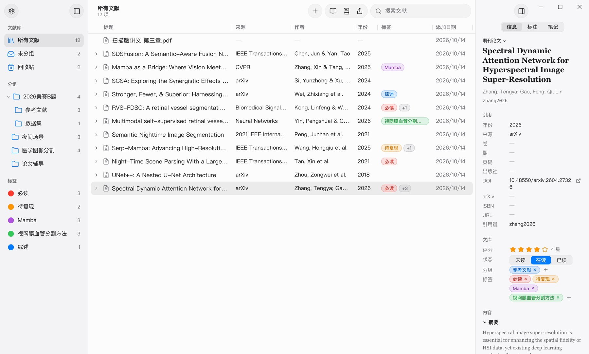
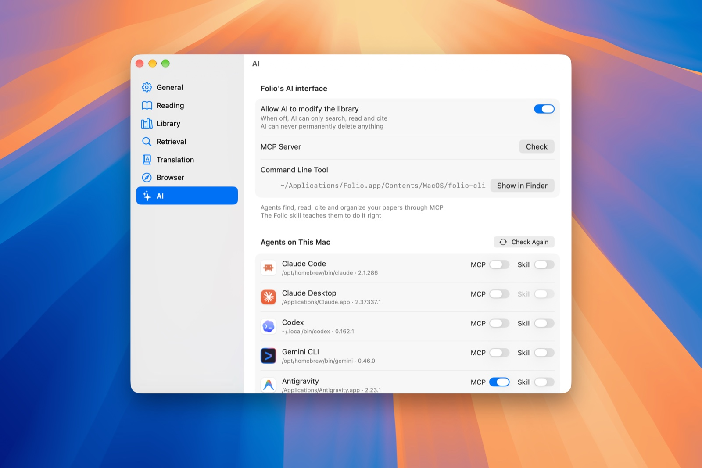

<div align="center">


# Folio

**An open-source reference manager for people who read papers, with one library for Mac and Windows**

Drop in a PDF and the item builds itself · Annotations live in the file · Translate whole papers with the layout intact · Let AI agents read your library

[](https://github.com/Alonemo-Nnqc/Folio/releases/latest)
[](https://github.com/Alonemo-Nnqc/Folio/actions/workflows/ci.yml)
[](#installation)
[](#installation)
[](LICENSE)

[Website](https://alonemo-nnqc.github.io/Folio/) · [Download](https://github.com/Alonemo-Nnqc/Folio/releases/latest) · [简体中文](README.md) | English



</div>

## Why Folio

**One library, on either system.** The Mac and Windows apps match feature for feature and share one library format. Put the library folder in a synced drive, and the Windows PC in the lab and the Mac at home open the same papers, annotations and notes. No account, no server.

**A translated paper still looks like the paper.** The translation engine is built in, with nothing to download. Formulas are kept glyph by glyph, tables are translated cell by cell, text inside figures stays put, and citations and section links stay clickable. You can read side by side while it works.

**Translate with the AI you already signed in to.** The 19 agents Folio knows, such as Claude Code, Codex and Gemini CLI, work as translation services with no extra API key. Or choose free services, local models such as Ollama, or 17 LLM and translation APIs: 40 options in all.

**Your agents can read your library.** A built-in MCP server (26 tools) and the `folio-cli` command-line tool. Folio finds the agents on your computer and each takes a single switch. They can find papers from a description, read full text and annotations, and write accurate citations, or you can keep them read-only.

**Annotations belong to the PDF.** Highlights, sticky notes and ink are written into the file itself, so any reader can show them. Notes are plain Markdown.

**Your data stays yours.** The library lives on your computer, no usage data is collected, and the code is MIT licensed. Coming from Zotero? Import everything in one go, without changing Zotero.

## Features

| | |
| --- | --- |
| **Add papers** | Drop a PDF to identify its title, authors, venue and DOI within seconds (Zotero recognizer + Crossref / arXiv / OpenAlex / DBLP / CVF), add by DOI, arXiv ID or ISBN, or match by hand |
| **Read and annotate** | Tabs, highlights, underlines, strikethroughs, sticky notes, text boxes and ink; Folio remembers your place in every paper; press Space for Quick Look |
| **Translate** | Whole papers, many papers at once, side-by-side reading and selected text; an automatic glossary keeps terms consistent, and finished paragraphs are cached |
| **Organize** | Two-level collections, colour tags, a trash, full-text search, reading status, star ratings, and several files per item |
| **Notes** | One Markdown note per item; add selected text in one click while reading |
| **Cite and export** | GB/T 7714-2015, APA, IEEE, MLA, Chicago, Harvard, Vancouver, Nature and BibTeX; export BibTeX, RIS and CSL JSON |
| **Browser extensions** | Chrome, Edge, Brave, Arc, Firefox and more, plus Safari on Mac; save a paper in one click, or many from search results |
| **AI integration** | MCP server, `folio-cli` and the Folio skill, with one-switch setup for 19 agents including Claude Code, Codex, Gemini CLI, Copilot CLI, Cursor CLI, Pi, Grok CLI and Hermes Agent |
| **Look and language** | Dark mode, English and Simplified Chinese; Liquid Glass on macOS 26, acrylic on Windows 11 |
| **Updates** | Checks in the app, downloads in the background, installs on relaunch |

## Screenshots

<table>
  <tr>
    <td width="50%"></td>
    <td width="50%"></td>
  </tr>
  <tr>
    <td align="center"><b>Read and annotate</b>: highlights and notes saved into the PDF</td>
    <td align="center"><b>Side by side</b>: the translation next to the original, layout intact</td>
  </tr>
  <tr>
    <td width="50%"></td>
    <td width="50%"></td>
  </tr>
  <tr>
    <td align="center"><b>Folio for Windows</b>: the same features and the same library</td>
    <td align="center"><b>AI integration</b>: MCP and skills for your agents, one switch each</td>
  </tr>
</table>

## Installation

Download the installer for your system from [Releases](https://github.com/Alonemo-Nnqc/Folio/releases/latest). Later versions install themselves through in-app updates.

| System | Requires | Installer |
| --- | --- | --- |
| macOS | macOS 14 Sonoma or later, Apple silicon or Intel | `Folio-x.y.z-macOS.dmg` |
| Windows (Intel / AMD) | Windows 10 2004 or later | `Folio-x.y.z-Windows-x64-Setup.exe` |
| Windows (ARM) | Windows 10 2004 or later | `Folio-x.y.z-Windows-ARM64-Setup.exe` |

**macOS**: open the DMG and drag Folio to Applications. Folio isn't notarized by Apple yet, so the first time you open it macOS can't verify the developer. Go to **System Settings ▸ Privacy & Security** and click **Open Anyway** near the bottom, or run this in Terminal:

```bash
xattr -dr com.apple.quarantine /Applications/Folio.app
```

**Windows**: run the installer. It needs no administrator rights and no separate .NET install. Folio isn't code-signed yet, so if Windows says "Windows protected your PC", click **More info**, then **Run anyway**. See [windows/README.md](windows/README.md) for more.

## Usage

The first time you open Folio, a welcome guide walks you through a few optional steps: importing a Zotero library, installing the browser extension, adding MCP and skills to your agents, and choosing a translation service.

| | macOS | Windows |
| --- | --- | --- |
| Add files | ⌘O | Ctrl+O |
| Add by DOI / arXiv / ISBN | ⇧⌘O | Ctrl+Shift+O |
| Translate selection (default) | ⌥D | Alt+D |
| Default library location | `~/Folio` | `Folio` in your user folder |

- **Library location** can be changed in Settings ▸ Library. For a synced library, point both systems at the same folder
- **Translating a paper**: right-click an item ▸ Translate Paper…, or select several to translate them together. Choose a service in Settings ▸ Translation; on Mac you can also use Apple's on-device translation (macOS 26)
- **Language** follows your system by default and can be set to Simplified Chinese or English in Settings ▸ General

### AI integration

`folio-cli` is installed with the app (`/Applications/Folio.app/Contents/MacOS/folio-cli` on Mac, next to `Folio.exe` on Windows):

- `folio-cli mcp`: a stdio MCP server with 26 tools for search (author, year, tag, full text), reading full text and annotations, citations in nine formats, import and export, adding by DOI / arXiv / PDF / URL, collections, tags and notes
- `folio-cli search | get | cite | export | add | open`: for agents that can only run commands; `folio-cli status` checks the library and permissions
- The Folio skill (`SKILL.md`) teaches agents how to find papers from a description, cite accurately, and when to ask you first

In **Settings ▸ AI**, Folio lists only the agents available on your computer, each with an MCP switch and a skill switch. It writes configuration the way each agent documents, backs it up first, and removes it when you switch off. Turn off "Allow AI to modify the library" to keep agents read-only. Editors such as VS Code, Zed and Windsurf can be set up by hand with "Copy MCP Configuration".

### Browser extensions

While Folio runs, it offers a local connector on `127.0.0.1:23120` that accepts requests only from the browser extension and can be turned off in Settings ▸ Browser, where you'll also find step-by-step setup:

- **Chrome / Edge / Brave / Arc and others**: click "Install…" in Settings, turn on Developer mode on the browser's extensions page, choose "Load unpacked" and select the folder Folio prepared. The extension files update along with Folio
- **Firefox**: use "Load Temporary Add-on" in `about:debugging`
- **Safari (Mac)**: the extension ships with Folio.app. Turn on "Show features for web developers" in Safari Settings ▸ Advanced, check "Allow Unsigned Extensions" in the Developer tab (needed each time Safari reopens), then enable the Folio extension in Extensions

## Privacy

Folio collects no usage data, and your library stays on your own computer. API keys for translation services are encrypted by the system (Keychain on Mac, DPAPI on Windows). Folio goes online only to:

- Identify metadata through the Zotero recognizer, Crossref, arXiv, OpenAlex, DBLP and others (the Zotero recognizer can be turned off in Settings)
- Translate papers by sending their text to the service you chose (local models and Apple's translation send nothing out)
- Check for updates on GitHub Releases (automatic checks can be turned off in Settings)

## Building from source

```bash
git clone https://github.com/Alonemo-Nnqc/Folio.git
```

**macOS** needs Xcode 27 or later and [XcodeGen](https://github.com/yonaskolb/XcodeGen) (`brew install xcodegen`), but no Apple developer account.

```bash
cd Folio/macos
script/build_and_run.sh
```

**Windows** needs the .NET 10 SDK, Node 22 and pnpm. The steps are in [windows/README.md](windows/README.md).

Project structure, tests and releases are covered in [CONTRIBUTING.md](CONTRIBUTING.md).

## Contributing

[Issues](https://github.com/Alonemo-Nnqc/Folio/issues) and pull requests are welcome. Please read the [contributing guide](CONTRIBUTING.md) and [code of conduct](CODE_OF_CONDUCT.md) first, and report security problems privately as described in the [security policy](SECURITY.md). Changes are listed in [CHANGELOG.md](CHANGELOG.md).

## Acknowledgements

Folio is built on many excellent open-source projects and services, including [GRDB.swift](https://github.com/groue/GRDB.swift), [Sparkle](https://github.com/sparkle-project/Sparkle), [pdf.js](https://github.com/mozilla/pdf.js), [PdfPig](https://github.com/UglyToad/PdfPig), [SkiaSharp](https://github.com/mono/SkiaSharp), [React](https://github.com/facebook/react), [citeproc-js](https://github.com/Juris-M/citeproc-js), [CSL styles](https://citationstyles.org) and the [Zotero recognizer](https://www.zotero.org). The full list with licenses is in [THIRD-PARTY-NOTICES.md](THIRD-PARTY-NOTICES.md).

## License

Folio is open source under the [MIT License](LICENSE). Bundled third-party components follow their own licenses.
