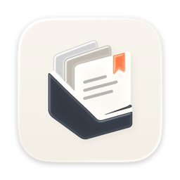
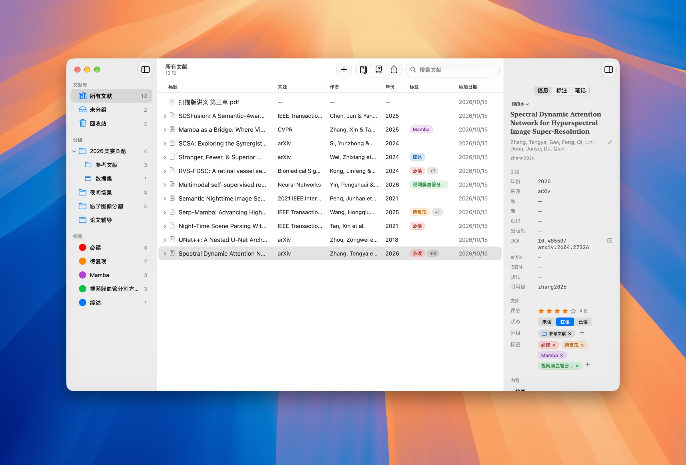
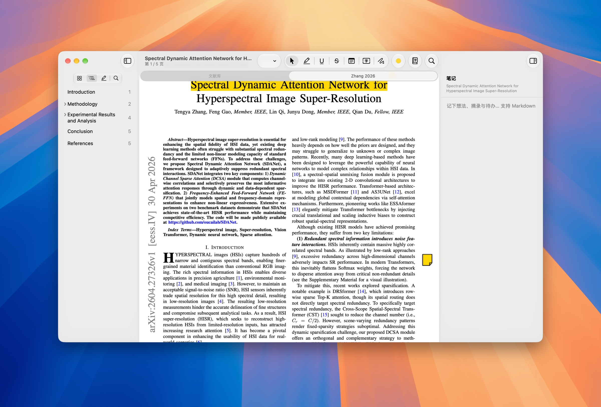
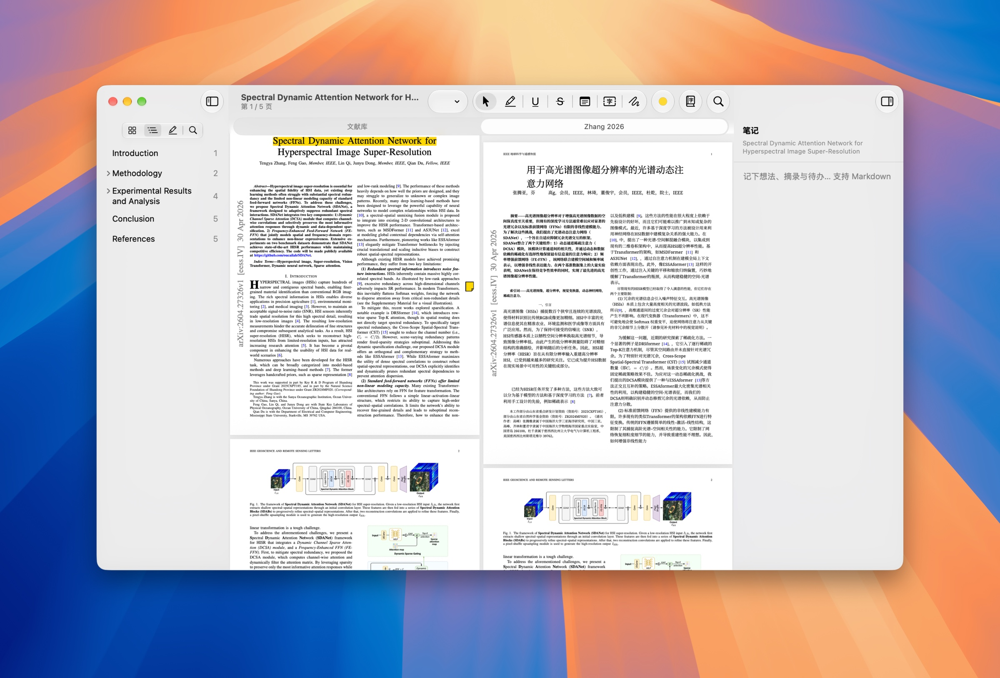
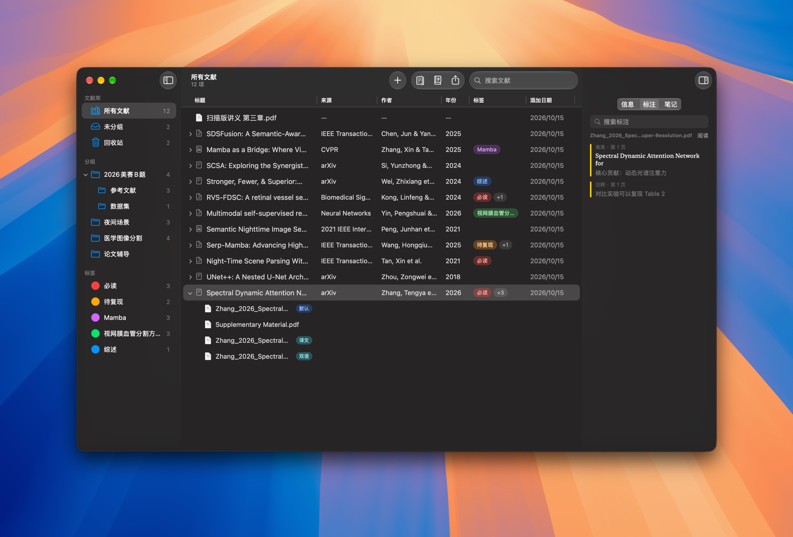

<div align="center">



# Folio

**轻量、原生的 macOS 文献管理软件**

拖入 PDF 自动识别元数据 · 内置阅读与批注 · 保留排版的整篇翻译 · AI 智能体接入

[](https://github.com/Alonemo-Nnqc/Folio/releases/latest)
[](https://github.com/Alonemo-Nnqc/Folio/actions/workflows/ci.yml)
[](#安装)
[](LICENSE)

简体中文 | [English](README.en.md)



</div>

## 功能

- **自动识别**：拖入 PDF 后几秒内识别标题、作者、期刊、DOI 等元数据并创建条目（Zotero 识别服务 + Crossref / arXiv / OpenAlex / DBLP / CVF），找不到时可手动匹配
- **内置阅读器**：与“预览”同一引擎（PDFKit），论文以原生标签页打开；高亮、下划线、删除线、便签、文本框、手绘，批注直接写回 PDF，与“预览”互通；记住每篇论文的阅读位置
- **整篇翻译**：保留排版的全文翻译（[pdf2zh_next / BabelDOC](https://github.com/PDFMathTranslate/PDFMathTranslate-next)），支持 20 多种翻译服务，译文与原文可并排对照阅读
- **笔记**：每个条目一篇 Markdown 笔记，阅读时可把选中的文字一键加入笔记
- **整理**：两级分组（可自定义颜色）、彩色标签、回收站、全文搜索、阅读状态与星级评分；一个条目可挂多个文件
- **引用与导出**：复制 GB/T 7714-2015、APA、IEEE、MLA、Chicago、Harvard、Vancouver、Nature 和 BibTeX 引用，导出 BibTeX / RIS / CSL JSON
- **AI 接入**：内置 MCP 服务器和命令行工具 `folio-cli`，在 设置 ▸ AI 中一键为 Claude Code、Codex、Gemini CLI、Copilot CLI、Cursor CLI 等 11 种智能体添加
- **浏览器插件**：Safari、Chrome、Edge、Brave、Arc、Firefox 等，在论文页面一键保存到 Folio（可同时保存 PDF），搜索结果页可批量保存
- **从 Zotero 迁移**：一键导入条目、PDF、分组和标签（只读取数据库副本，不会修改 Zotero）
- **自动更新**：应用内检查更新，后台下载，重新启动即完成安装
- **轻快**：1000 个条目时冷启动约 0.35 秒，内存约 110–130 MB

## 截图

| 阅读与批注 | 原文 / 译文对照阅读 |
| :---: | :---: |
|  |  |
| **深色模式、多文件与标注** | |
|  | |

## 安装

系统要求：macOS 26 及以上（Apple 芯片或 Intel）。

1. 在 [Releases](https://github.com/Alonemo-Nnqc/Folio/releases/latest) 下载最新的 `Folio-x.y.z.dmg`
2. 打开 DMG，把 **Folio** 拖到“应用程序”文件夹
3. 首次打开：Folio 目前没有经过 Apple 公证，macOS 会提示“无法验证开发者”。请打开 **系统设置 ▸ 隐私与安全性**，在页面底部点 **仍要打开**，再确认一次即可。

   也可以在终端中移除隔离属性后直接打开：

   ```bash
   xattr -dr com.apple.quarantine /Applications/Folio.app
   ```

之后的版本会通过应用内更新自动安装，不需要再重复这一步。

### 更新

Folio 每天自动检查一次更新，也可以随时点 **Folio ▸ 检查更新…**。在 **设置 ▸ 通用 ▸ 软件更新** 中可以选择是否自动检查、是否在后台自动下载（退出时安装）。更新包从 GitHub Releases 下载，安装前会校验 EdDSA 签名。

## 使用

- **添加文献**：把 PDF 拖进窗口，或 文件 ▸ 添加文件…（⌘O）、通过 DOI / arXiv 编号 / ISBN 添加（⇧⌘O）
- **文献库位置**：默认 `~/Folio`，可在 设置 ▸ 文献库 中更改
- **整篇翻译**：在条目上右键 ▸ 翻译全文…。首次使用时按提示下载翻译组件（约几百 MB，存放在 `~/Library/Application Support/Folio/Translator`），在 设置 ▸ 翻译 中选择翻译服务

### AI 接入

Folio.app 内附带 `folio-cli`（`/Applications/Folio.app/Contents/MacOS/folio-cli`）：

- `folio-cli mcp`：stdio 方式的 MCP 服务器，26 个工具：检索（作者、年份、标签、全文）、读取全文与批注、9 种格式的引用、导入导出、按 DOI / arXiv / PDF / 网址添加、分组与标签管理、笔记等
- `folio-cli search | get | cite | export | add | open`：供只能运行命令的智能体使用；`folio-cli status` 检查文献库与权限
- Folio 技能（`SKILL.md`）教智能体如何根据描述找到论文、准确引用，以及哪些操作需要先问你

在 **设置 ▸ AI** 中，Folio 只列出本机可用的智能体，每个智能体有“MCP”“技能”两个开关，按各智能体官方的方式写入配置，关闭即移除。也可以关闭“允许 AI 修改文献库”，只让 AI 读取。VS Code、Zed、Windsurf 等编辑器可用“拷贝 MCP 配置”手动添加。

### 浏览器插件

Folio 运行时在 `127.0.0.1:23120` 提供本地连接服务（只接受浏览器扩展的请求，可在 设置 ▸ 浏览器 中关闭）。在论文页面点工具栏上的 Folio 按钮（或 ⌘⇧S）即可保存，设置 ▸ 浏览器 中有分步安装引导：

- **Safari**：扩展随 Folio.app 提供。由于 Folio 未经 Apple 公证，需要先在 Safari 设置 ▸ 高级 中打开“显示网页开发者功能”，再在 开发者 中勾选“允许未签名的扩展”（每次重新打开 Safari 后需再次勾选），然后在 扩展 中启用“Folio 文献保存”
- **Chrome / Edge / Brave / Arc 等**：在设置中点“安装…”，然后在浏览器扩展页打开“开发者模式”，“加载已解压的扩展程序”，选择 Folio 准备好的文件夹。Folio 更新后扩展文件会自动更新
- **Firefox**：在 `about:debugging` 中“临时载入附加组件”

每个版本的 Releases 页面也附带了扩展的 `.zip`（Chromium）和 `.xpi`（Firefox）安装包。

## 隐私

Folio 不收集任何使用数据，文献库完全保存在你的 Mac 上。只有以下情况会访问网络：

- 识别元数据：向 Zotero 识别服务、Crossref、arXiv、OpenAlex、DBLP 等查询（Zotero 识别服务可在设置中关闭）
- 整篇翻译：把论文文本发送给你选择的翻译服务（也可选择离线的 Apple 系统翻译）
- 检查更新：读取 GitHub Releases 上的 `appcast.xml`（可在设置中关闭自动检查）

翻译服务的 API 密钥保存在系统钥匙串中。

## 从源码构建

需要 Xcode 27 及以上和 [XcodeGen](https://github.com/yonaskolb/XcodeGen)（`brew install xcodegen`）：

```bash
git clone https://github.com/Alonemo-Nnqc/Folio.git
cd Folio
script/build_and_run.sh
```

不需要 Apple 开发者账号。工程结构、测试和发布流程见 [CONTRIBUTING.md](CONTRIBUTING.md)。

## 参与贡献

欢迎提交 [Issue](https://github.com/Alonemo-Nnqc/Folio/issues) 和 Pull Request！开始之前请阅读 [贡献指南](CONTRIBUTING.md) 和 [行为准则](CODE_OF_CONDUCT.md)。安全问题请按 [安全策略](SECURITY.md) 私密报告。版本变更记录见 [CHANGELOG.md](CHANGELOG.md)。

## 致谢

Folio 使用了以下开源项目和服务：

| 项目 | 用途 | 许可证 |
| --- | --- | --- |
| [GRDB.swift](https://github.com/groue/GRDB.swift) | SQLite 数据库 | MIT |
| [Sparkle](https://github.com/sparkle-project/Sparkle) | 应用内更新 | MIT |
| [citeproc-js](https://github.com/Juris-M/citeproc-js) | 引用格式生成（随 App 打包） | CPAL-1.0 / AGPL-1.0 |
| [CSL 样式与 locale](https://citationstyles.org) | 引用样式 | CC BY-SA 3.0 |
| [pdf2zh_next / BabelDOC](https://github.com/PDFMathTranslate/PDFMathTranslate-next) | 整篇翻译（不随 App 打包，首次使用时按需下载） | AGPL-3.0 |
| [Zotero 识别服务](https://www.zotero.org) | PDF 元数据识别 | — |

资源文件的详细出处见 [`LICENSES.md`](Packages/FolioCore/Sources/FolioCitation/Resources/LICENSES.md)。

## 许可证

Folio 以 [MIT 许可证](LICENSE) 开源。随附的第三方组件遵循各自的许可证。
