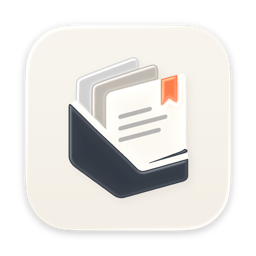
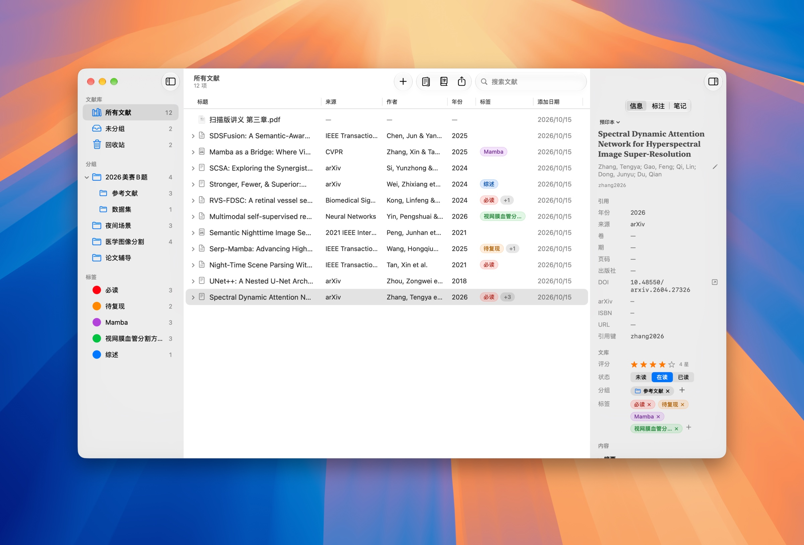
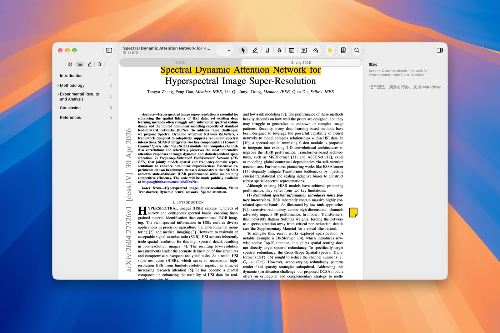
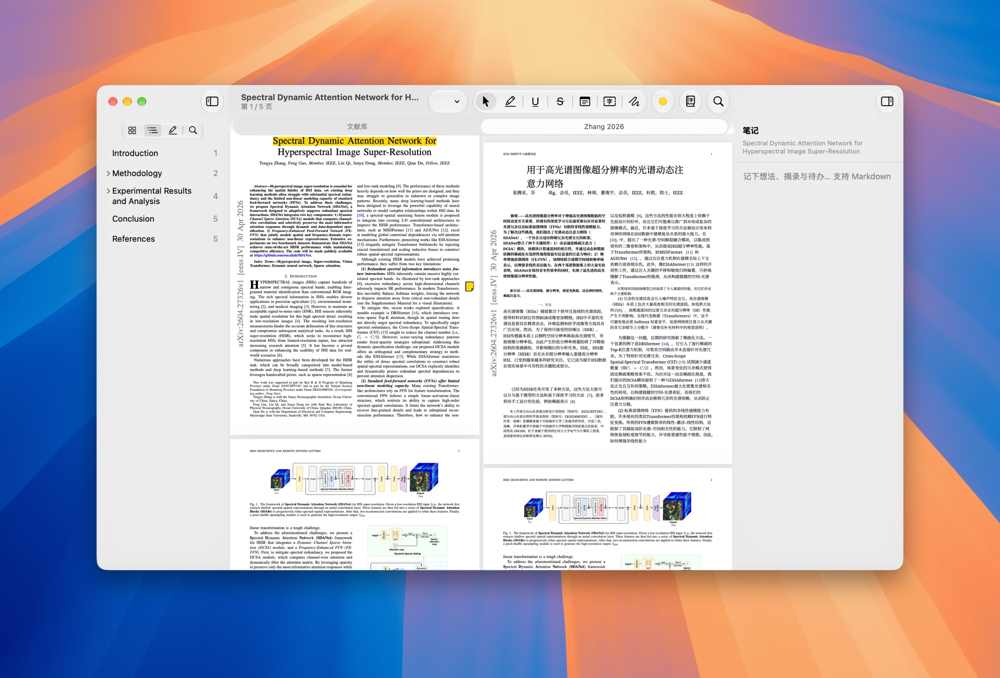
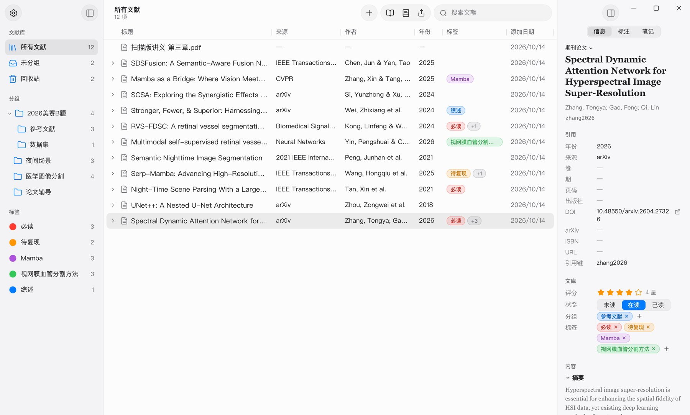
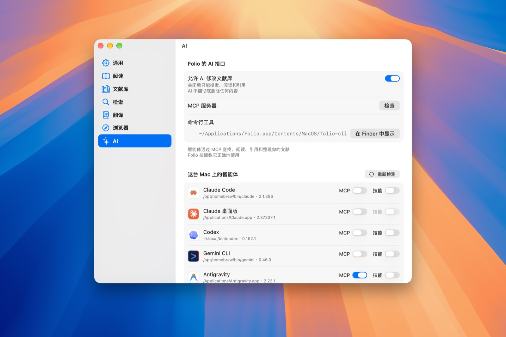

<div align="center">



# Folio

**写给读论文的人的开源文献管理软件，Mac 和 Windows 用同一个文献库**

拖入 PDF 自动建好条目 · 批注写进文件 · 整篇翻译不动排版 · AI 智能体直接读你的文献库

[](https://github.com/Alonemo-Nnqc/Folio/releases/latest)
[](https://github.com/Alonemo-Nnqc/Folio/actions/workflows/ci.yml)
[](#安装)
[](#安装)
[](LICENSE)

[产品主页](https://alonemo-nnqc.github.io/Folio/) · [下载](https://github.com/Alonemo-Nnqc/Folio/releases/latest) · 简体中文 | [English](README.en.md)



</div>

## 为什么选择 Folio

**一个文献库，两个系统都能打开。** Mac 版和 Windows 版功能一一对应，文献库格式完全相同。把文献库文件夹放进同步盘，实验室的 Windows 和家里的 Mac 打开的就是同一份论文、批注和笔记。不用注册账号，也没有服务器。

**翻译完，还是原来那篇论文。** 翻译引擎内置，无需下载。公式逐字形保留，表格逐格翻译，图内文字不动，译文里的引用和章节链接依然能点。翻译途中就能对照阅读。

**用你已经登录的 AI 来翻译。** 电脑上的 Claude Code、Codex、Gemini CLI 等 19 种智能体可以直接当翻译服务，不用另配 API Key。也可以选免费接口、Ollama 等本地模型，或 17 种大模型与机器翻译 API，一共 40 种。

**AI 智能体能读懂你的文献库。** 内置 MCP 服务器（26 个工具）和命令行工具 `folio-cli`。Folio 会找到电脑上的智能体，每个只需打开一个开关。智能体可以按描述找论文、读全文和批注、生成准确的引用；也可以设为只读。

**批注属于 PDF，不属于软件。** 高亮、便签、手绘都写进 PDF 文件本身，换任何阅读器都能看到。笔记是普通的 Markdown。

**数据在你自己手里。** 文献库保存在本地，不收集任何使用数据，MIT 开源。已有 Zotero 文献库的话，一键就能迁移过来，且不会改动 Zotero。

## 功能一览

| | |
| --- | --- |
| **添加文献** | 拖入 PDF，几秒内识别标题、作者、期刊、DOI 等（Zotero 识别服务 + Crossref / arXiv / OpenAlex / DBLP / CVF），也可通过 DOI、arXiv 编号、ISBN 添加，找不到时手动匹配 |
| **阅读与批注** | 标签页阅读，高亮、下划线、删除线、便签、文本框、手绘，记住每篇论文的阅读位置，按空格快速预览 |
| **翻译** | 整篇翻译、批量翻译、原文译文对照阅读、划词翻译；自动提取术语表，让专有名词前后一致；已译段落会缓存 |
| **整理** | 两级分组、彩色标签、回收站、全文搜索、阅读状态、星级评分，一个条目可挂多个文件 |
| **笔记** | 每个条目一篇 Markdown 笔记，阅读时可把选中的文字一键加入 |
| **引用与导出** | GB/T 7714-2015、APA、IEEE、MLA、Chicago、Harvard、Vancouver、Nature、BibTeX，导出 BibTeX / RIS / CSL JSON |
| **浏览器插件** | Chrome、Edge、Brave、Arc、Firefox 等，Mac 上还有 Safari；在论文页面一键保存，搜索结果页可批量保存 |
| **AI 接入** | MCP 服务器、`folio-cli`、Folio 技能，一键接入 Claude Code、Codex、Gemini CLI、Copilot CLI、Cursor CLI、Pi、Grok CLI、Hermes Agent 等 19 种智能体 |
| **外观与语言** | 深色模式，简体中文和英文界面；macOS 26 上是 Liquid Glass，Windows 11 上是亚克力 |
| **更新** | 应用内检查更新，后台下载，重新启动即完成安装 |

## 截图

<table>
  <tr>
    <td width="50%"></td>
    <td width="50%"></td>
  </tr>
  <tr>
    <td align="center"><b>阅读与批注</b>：高亮、便签直接写回 PDF</td>
    <td align="center"><b>对照阅读</b>：保留排版的译文与原文并排</td>
  </tr>
  <tr>
    <td width="50%"></td>
    <td width="50%"></td>
  </tr>
  <tr>
    <td align="center"><b>Windows 版</b>：功能一致，文献库互通</td>
    <td align="center"><b>AI 接入</b>：一键为本机的智能体添加 MCP 与技能</td>
  </tr>
</table>

## 安装

在 [Releases](https://github.com/Alonemo-Nnqc/Folio/releases/latest) 下载对应系统的安装包。之后的版本会通过应用内更新自动安装。

| 系统 | 要求 | 安装包 |
| --- | --- | --- |
| macOS | macOS 14 Sonoma 及以上，Apple 芯片或 Intel | `Folio-x.y.z-macOS.dmg` |
| Windows（Intel / AMD） | Windows 10 2004 及以上 | `Folio-x.y.z-Windows-x64-Setup.exe` |
| Windows（ARM） | Windows 10 2004 及以上 | `Folio-x.y.z-Windows-ARM64-Setup.exe` |

**macOS**：打开 DMG，把 Folio 拖到“应用程序”文件夹。Folio 目前没有经过 Apple 公证，首次打开时 macOS 会提示“无法验证开发者”，请到 **系统设置 ▸ 隐私与安全性**，在页面底部点 **仍要打开**。也可以在终端中运行：

```bash
xattr -dr com.apple.quarantine /Applications/Folio.app
```

**Windows**：运行安装程序即可，不需要管理员权限，也不需要另外安装 .NET。Folio 目前没有代码签名，如果看到“Windows 已保护你的电脑”，点 **更多信息**，再点 **仍要运行**。更多说明见 [windows/README.md](windows/README.md#安装)。

## 使用

第一次打开时，欢迎向导会带你完成几项设置（每一步都可以跳过）：导入 Zotero 文献库、安装浏览器插件、为本机的 AI 智能体添加 MCP 与技能、选择翻译服务。

| | macOS | Windows |
| --- | --- | --- |
| 添加文件 | ⌘O | Ctrl+O |
| 通过 DOI / arXiv / ISBN 添加 | ⇧⌘O | Ctrl+Shift+O |
| 划词翻译（默认） | ⌥D | Alt+D |
| 默认文献库位置 | `~/Folio` | 用户文件夹下的 `Folio` |

- **文献库位置**可在 设置 ▸ 文献库 中更改；放进同步盘后，两个系统指向同一个文件夹即可
- **整篇翻译**：在条目上右键 ▸ 翻译全文…，或多选后批量翻译。在 设置 ▸ 翻译 中选择服务；Mac 上还可使用离线的 Apple 系统翻译（需要 macOS 26）
- **界面语言**：默认跟随系统，也可在 设置 ▸ 通用 中固定为简体中文或 English

### AI 接入

`folio-cli` 随应用一起安装（Mac 在 `/Applications/Folio.app/Contents/MacOS/folio-cli`，Windows 在 `Folio.exe` 旁边）：

- `folio-cli mcp`：stdio 方式的 MCP 服务器，26 个工具，包括检索（作者、年份、标签、全文）、读取全文与批注、9 种格式的引用、导入导出、按 DOI / arXiv / PDF / 网址添加、分组与标签管理、笔记等
- `folio-cli search | get | cite | export | add | open`：供只能运行命令的智能体使用；`folio-cli status` 检查文献库与权限
- Folio 技能（`SKILL.md`）教智能体如何根据描述找到论文、准确引用，以及哪些操作需要先问你

在 **设置 ▸ AI** 中，Folio 只列出本机可用的智能体，每个智能体有“MCP”“技能”两个开关，按各智能体官方的方式写入配置，修改前自动备份，关闭即移除。关闭“允许 AI 修改文献库”后，AI 只能读取。VS Code、Zed、Windsurf 等编辑器可用“拷贝 MCP 配置”手动添加。

### 浏览器插件

Folio 运行时在 `127.0.0.1:23120` 提供本地连接服务（只接受浏览器扩展的请求，可在 设置 ▸ 浏览器 中关闭）。设置 ▸ 浏览器 中有分步安装引导：

- **Chrome / Edge / Brave / Arc 等**：在设置中点“安装…”，然后在浏览器扩展页打开“开发者模式”，“加载已解压的扩展程序”，选择 Folio 准备好的文件夹。Folio 更新后扩展文件会自动更新
- **Firefox**：在 `about:debugging` 中“临时载入附加组件”
- **Safari（Mac）**：扩展随 Folio.app 提供。需要先在 Safari 设置 ▸ 高级 中打开“显示网页开发者功能”，再在 开发者 中勾选“允许未签名的扩展”（每次重新打开 Safari 后需再次勾选），然后在 扩展 中启用“Folio 文献保存”

## 隐私

Folio 不收集任何使用数据，文献库完全保存在你自己的电脑上。翻译服务的 API 密钥由系统加密保存（Mac 使用钥匙串，Windows 使用 DPAPI）。只有以下情况会访问网络：

- 识别元数据：向 Zotero 识别服务、Crossref、arXiv、OpenAlex、DBLP 等查询（Zotero 识别服务可在设置中关闭）
- 整篇翻译：把论文文本发送给你选择的翻译服务（本地模型和 Apple 系统翻译不会发送到外部）
- 检查更新：从 GitHub Releases 读取版本信息（可在设置中关闭自动检查）

## 从源码构建

```bash
git clone https://github.com/Alonemo-Nnqc/Folio.git
```

**macOS**：需要 Xcode 27 及以上和 [XcodeGen](https://github.com/yonaskolb/XcodeGen)（`brew install xcodegen`），不需要 Apple 开发者账号。

```bash
cd Folio/macos
script/build_and_run.sh
```

**Windows**：需要 .NET 10 SDK、Node 22 和 pnpm，步骤见 [windows/README.md](windows/README.md#构建与测试)。

工程结构、测试和发布流程见 [CONTRIBUTING.md](CONTRIBUTING.md)。

## 参与贡献

欢迎提交 [Issue](https://github.com/Alonemo-Nnqc/Folio/issues) 和 Pull Request！开始之前请阅读 [贡献指南](CONTRIBUTING.md) 和 [行为准则](CODE_OF_CONDUCT.md)。安全问题请按 [安全策略](SECURITY.md) 私密报告。版本变更记录见 [CHANGELOG.md](CHANGELOG.md)。

## 致谢

Folio 建立在许多优秀的开源项目和服务之上，包括 [GRDB.swift](https://github.com/groue/GRDB.swift)、[Sparkle](https://github.com/sparkle-project/Sparkle)、[pdf.js](https://github.com/mozilla/pdf.js)、[PdfPig](https://github.com/UglyToad/PdfPig)、[SkiaSharp](https://github.com/mono/SkiaSharp)、[React](https://github.com/facebook/react)、[citeproc-js](https://github.com/Juris-M/citeproc-js)、[CSL 样式](https://citationstyles.org)和 [Zotero 识别服务](https://www.zotero.org)。完整列表与许可证见 [THIRD-PARTY-NOTICES.md](THIRD-PARTY-NOTICES.md)。

## 许可证

Folio 以 [MIT 许可证](LICENSE) 开源。随附的第三方组件遵循各自的许可证。
